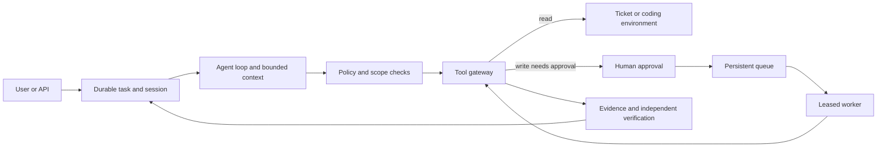

# SafeHarness

**A resumable, auditable execution harness for tool-using agents.** SafeHarness combines a model/tool loop with durable tasks, policy checks, human approval, isolated coding workspaces, and recovery from uncertain outcomes. It is a personal engineering project and research prototype; the supported scope and evidence below are deliberately specific.

**Repository:** [github.com/564264850/safeharness](https://github.com/564264850/safeharness)

## Try it locally

The default demo uses a scripted agent and SQLite. It needs no API key, paid model call, Docker, or PostgreSQL.

```powershell
uv sync --locked --extra service --extra judge --python 3.11
uv run --no-sync python scripts/queued_approval_demo.py
```

The demo creates a task, waits at human approval, restarts the local API process, approves the unchanged tool arguments, and lets a worker resume the task. A successful report checks one business write and zero manual resume calls. To run the deterministic test suite locally:

```powershell
uv run --no-sync pytest -m "not acceptance"
uv run --no-sync ruff check src tests scripts
uv run --no-sync ruff format --check src tests scripts
```

The full non-acceptance regression requires Docker Desktop's Linux engine and PostgreSQL. Enable its gated cases before running pytest:

```powershell
$env:SAFEHARNESS_DOCKER_TESTS = "1"
$env:SAFEHARNESS_POSTGRES_TESTS = "1"
uv run --no-sync pytest -q -m "not acceptance"
```

Docker and PostgreSQL are needed for the full integration matrix. The optional DeepSeek and OpenJudge paths require separately configured credentials and can incur provider charges; neither is needed for the default demo or deterministic evaluation.

## What the runtime does



The core loop and task state machine are implemented in this repository. Tasks, approvals, invocation records, checkpoints, leases, and audit events are persisted in SQLite or PostgreSQL. Tool writes are checked before dispatch; uncertain external outcomes stop for reconciliation or human review. Coding tasks run in a constrained Docker worker. The scheduler currently queues deterministic ticket scenarios; model-backed and coding runs use explicit run/resume paths.

## Evidence available in this checkout

These are reproducible project results, with the full scope and caveats linked in the evidence files. They are engineering evidence, not a production certification or a claim about arbitrary external APIs.

| Check | Recorded result | Scope |
| --- | --- | --- |
| Current regression rerun | 493 passed, 0 skipped | Docker and PostgreSQL enabled; Windows host, 2026-11-15 |
| Prior regression baseline | 483 passed, 0 skipped | Docker and PostgreSQL enabled; recorded 2026-11-14 |
| Fixed development acceptance | 120 instances passed | Development dataset, not a holdout benchmark |
| Repeated scheduler fault windows | 240 test instances passed | Four named fault windows, SQLite and PostgreSQL, 30 repetitions each |
| Healthy scheduler soak | 3,600.406 seconds; 1,165 tasks finished | Scripted fixed-ticket workload; 291 writes with 291 receipts and no duplicates |
| Approval and recovery demos | Passed | Local mock ticket business system; no paid model calls |
| Hosted CI | [Run 43618882633 passed](https://github.com/564264850/safeharness/actions/runs/43618882633) | Ubuntu 24.04; 493 regression tests plus 120 fixed acceptance cases; 0 paid API calls |

Portable machine-readable summaries and raw selected demo reports live in [the checked-in evidence bundle](docs/evidence/baseline/README.md). The prior detailed command reference remains available as the [CLI walkthrough](docs/cli-walkthrough.md); see the [document index](docs/index.md).

## Current limits

- The queue supports scripted ticket scenarios only; DeepSeek and coding are not yet durable queued workloads.
- Business-write recovery is verified against a local idempotent mock service, not arbitrary third-party APIs or a general exactly-once guarantee.
- The one-hour soak used a fixed ticket and status with a bounded submit rate. It does not establish throughput capacity, an SLA, or behavior under sustained outages.
- The approval path has no full operator resolution UI for `NEEDS_REVIEW` cases.
- Backup/restore drills, key rotation, TLS deployment, multi-tenant production hardening, and a 24-hour soak have not been completed.

## Project map

- `src/safeharness/` — agent loop, context, tools, policy, persistence, service, and scheduling.
- `tests/` — unit and integration contracts, including Docker and PostgreSQL cases.
- `scripts/` — local demos, fixed acceptance runs, and operational fault exercises.
- `docs/` — architecture, threat model, implementation history, and operating guides.
- `docs/job-oriented-plan.md` — next steps for improving the project as an Agent Runtime / AI application internship portfolio.
- `docs/external-review-triage.md` — independent review findings classified against current code and recorded evidence.

## Development notes

Python 3.11 is the validated environment. Locked dependencies are installed with `uv sync --locked --extra service --extra judge --python 3.11`. Docker Desktop with its Linux engine and a local PostgreSQL service are needed for the complete local integration run. The first hosted Ubuntu run passed on commit `724fceb`; its regression XML and deterministic demo reports are retained as a GitHub Actions artifact for 14 days. The workflow uses no paid model API.
