# R4 审批后的 Agent 续跑

本轮将“批准并完成一个工单写操作”与“完成整个用户任务”分开。新建 Harness 和 HTTP 任务默认走 Agent 审批模式：业务回执确认成功后保持 RUNNING，恢复原模型、上下文和工具队列，执行后续步骤，再经最终 verifier 决定任务终态。

## 实施内容

| 步骤 | 内容 | 入口 |
| --- | --- | --- |
| R4.1 | 每个任务可持久保存多次独立审批，旧数据保持旧语义 | `0012_approval_loop`、TaskStore |
| R4.2 | 校验当前审批与检查点中的 call、参数、工具版本一致，领取新代际后执行 | CheckpointSession.acquire / resolve_approval |
| R4.3 | 原业务幂等执行和回执核对，结果替换待审批结果，恢复模型队列及最终验证 | Harness.resume、Runtime、TaskStore.resume |
| R4.4 | HTTP 接入、读取真实最新工单状态、独立验证统一台账、最终验证 Trace | service、ToolGateway、runtime.verified |
| R4.5 | 连续同类失败停止、模型有限重试、容器清理确认重查 | Runtime、DeepSeek 开发脚本、DockerSandbox |
| R4.6 | SQLite/PG、崩溃边界、并发恢复、真实 DeepSeek、包与兼容验收 | 测试及 evidence |

```mermaid
flowchart LR
    A[模型提出工具调用] --> B[Gateway 参数和范围检查]
    B --> C[审批提议及检查点持久化]
    C --> D[WAITING_APPROVAL]
    D --> E[有权限的操作员批准参数摘要]
    E --> F[领取检查点代际]
    F --> G[按原 operation_id 执行或核对业务回执]
    G --> H[结果回填，任务仍为 RUNNING]
    H --> I[后续工具或再次申请审批]
    I --> J[模型最终回答]
    J --> K[最终 verifier]
    K --> L[SUCCEEDED / FAILED]
```



## 身份、恢复和预算

每次审批都有独立 approval_id / operation_id，后续写入不能复用前一次批准。一个批准操作沿用原 call_id，执行和恢复使用新的 attempt_id；审批记录和历史提议不改写。记录按任务内 sequence 排序，`show-approval` / HTTP 查询返回最新请求。

审批结果在工具队列继续之前保存为新的 after_tool 检查点。若业务已提交但检查点未保存，重新核对原业务回执后回填，不能再次写入。业务阶段成功不再直接结束 Agent 任务；后续读取和最终验证仍可以使任务失败。宿主控制面的审批不会变成模型可调用的 approve 工具。

审批等待时间排除在主动执行时限之外；步数、费用和已经产生的调用记录不重置。业务首次派发仍执行原有 24 小时批准有效期、参数摘要、工具/策略版本检查。普通暂停、模型调用和工具执行消耗主动时限。已在执行的检查点 owner 会阻止其他入口派发；人工确认进程退出后仍需显式 recover_abandoned 和 expected_generation 接管。

新建开发脚本和服务的默认 DeepSeek 预算为 **5 元、80 次请求**，参数可配置。原 m3-validation-v1 的 0.50 元账本保留历史设置，不清零。模型连接失败可按现有有界重试机制产生新 attempt，未知用量继续占用预留费用；业务工具不因此重放。

## Python 接入

```python
harness = Harness(
    store, model=agent, execute=gateway.execute, verify=verify_final_task,
    configuration={"application": "v2", "verifier": "v1"},
    approval_workspace=business,  # 当前为有幂等回执的工单适配器
    max_steps=12,
)
waiting = harness.run(task)
# 由可信操作员进行摘要绑定的批准；重新构造相同配置的对象后：
completed = harness.resume(task.task_id)
```

工具读取业务状态时使用实时 reader。继续使用首次运行时创建的静态字典，会读到旧状态；HTTP 接口和新演示已使用实时工单读取。

Harness 默认 `max_repeated_failures=3`：同一工具连续得到相同状态和错误码三次，进入 FAILED，错误码为 repeated_tool_failure。历史结果参与判断，暂停/续跑不能清零计数。它是基础停止策略，不包含语义重规划或任意循环检测；可显式配置或设为 None。底层兼容用的直接 `run_task` 仍默认关闭此策略。

## HTTP 与亲手操作

新增场景 `ticket_update_read`：更新工单需审批，批准执行后再读取真实状态。原 `ticket_update` 新任务也通过 Agent 回填和最终验证完成。任务所有者在批准后可使用 `/continue` 或 `/resume`；无批准、参数变更、权限撤销及他人任务仍会拒绝。

先用无付费模型的演示：

```powershell
Set-Location C:\Users\25587\Desktop\agent\safeharness
.\.venv\Scripts\python.exe scripts\approval_loop_demo.py
```

脚本暂停并输出 database、approval_id、arguments、arguments_sha256、demo_id。审阅参数后亲手执行：

```powershell
.\.venv\Scripts\python.exe -m safeharness --db <database> decide-approval <approval_id> approve --arguments-sha256 <arguments_sha256>
.\.venv\Scripts\python.exe scripts\approval_loop_demo.py --continue-demo <demo_id>
```

同一演示包含两次写入，因此会再次暂停。重新读取第二次输出，审阅并批准新的请求后再次 continue；最终应观察到 in_progress 和 resolved 两次回读。也可将 approve 改为 reject 验证拒绝路径。

自动化合成评审只用于本地测试，模型不具备评审身份：

```powershell
.\.venv\Scripts\python.exe scripts\approval_loop_demo.py --auto-review-for-test
.\.venv\Scripts\python.exe scripts\approval_loop_demo.py --provider deepseek --auto-review-for-test
```

第二条会产生付费请求。真实模型演示成功报告为 `artifacts/approval-loop-demos/f7b2c776-9124-4503-8d5e-2dd94239f268/report.json`，明确标注 review_source=synthetic_test_operator；它验证宿主和模型分工，不代表真实用户已经批准真实外部业务。

## 独立验证与运行稳定性

开发脚本使用单独工作区中的控制面测试，通过 `ToolGateway.verify_tests` 进入 Gateway、AuditLog 和 InvocationLedger；模型不能调用 `_verify_tests` 或扩大其测试路径。成功报告保存验证 call_id、attempt_id，台账 kind 为 verification。最终通用 verifier 的布尔结果另以 runtime.verified 记录。

真实开发脚本复测成功报告为 `artifacts/deepseek-builds/d9806174-2463-41ca-95b9-ee32d69f0587/report.json`，14 项独立测试通过且验证调用已登记。此前一次 provider_connection_error 的失败记录及未知费用预留保持原样。

Docker 清理现在最多两次删除/确认，只针对本次创建的容器名；只有查询明确证实容器不存在才视为清理完成。rm 单次返回错误不覆盖明确的不存在证据。查询失败、超时、输出不完整或容器仍存在时，仍返回 container_cleanup_failed 并停止后续执行。这没有给业务工具增加自动重试。

## 兼容与范围

迁移至 `0012_approval_loop` 时，原审批保留为 sequence=1，原会话的 approval_mode 保持 legacy，不伪造历史。原 M1 `request-update/resume` CLI 单步演示保持 legacy；原直接 run_task 的无检查点审批也沿用旧收尾。恢复旧会话时须使用与其配置匹配的 legacy 模式；配置指纹不匹配会拒绝恢复。

当前批准执行落地于已有工单回执适配器；增加新的外部写工具仍需接入其权限策略、参数校验及可核对的幂等回执。Coding 沙箱写仍按既有范围授权执行。没有自动恢复调度器、外部写撤销、通用补偿或任意系统的 exactly-once 承诺。

本轮最终证据汇总见 `docs/evidence/approval-loop-r4.json`。旧审计和历史失败证据保留，用于区分修复前后行为。

最终验收：**283/283 回归通过、0 跳过**，包含真实 Docker 和 PostgreSQL；固定开发矩阵 **120/120** 通过。本轮新增 20 项回归覆盖多次审批、队列回填、拒绝/无批准、配置变化、并发、三处崩溃窗口、等待时间、验证记账及清理确认。审批请求、任务等待状态与会话等待状态同事务保存，等待中的 owner 若未释放仍须显式接管。

新 wheel 的 54 个 Python 文件与当前源码逐字节一致，独立虚拟环境通过双审批演示；sdist 包含开发脚本需要的任务模板。旧数据库只对备份迁移，保留 4 条任务。Ruff、格式、依赖锁和凭据扫描通过，远程 GitHub CI 尚未执行。

本轮真实模型请求尝试合计 13 次，包含连接失败，费用上界为 **0.127390 元**；其中 2 次未知用量仍占用预留额度。独立测试属于开发功能验收，尚未构成针对恶意候选代码的完整防篡改评测边界。
