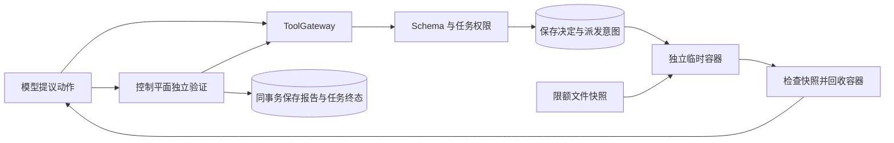

# Coding 沙箱运行与学习指南

M2 让工单与 Coding 共用工具入口。当前脚本模型修复 `clamp` 函数，代码确实在受限 Linux 容器中执行。真实模型在 M3 接入。

[R5 验证真实性修复](verification-truth.md)：`run_tests` 现在提供带完成状态和数量的开发反馈，不能单独决定最终成功。旧通用 `verify_tests` 已关闭，记账程序改为宿主核对观测合同；既有 clamp/函数合同仍由宿主比较预期输出。

## 执行流程



模型只提供工具和参数。镜像、Docker 参数、预算、文件授权、任务 ID 和验证入口都由可信控制平面提供。`TicketGateway` 保留兼容名称，使用与 Coding 相同的 `ToolGateway` 实现。批准后的业务恢复继续保存 M1 的执行意图及业务回执。

| 工具 | 参数 | 权限 |
| --- | --- | --- |
| `list_files` | 无 | 只列可读文件名 |
| `read_file` | `path` | 任务读取范围内的文件 |
| `write_file` | `path`、`content` | 任务写入范围内的文件，最多 8 KiB |
| `run_tests` | `paths` 数组 | 最多 8 个授权的 `tests/*.py` 文件；pytest 命令及选项由可信代码固定 |
| `_verify_coding_contract` | 控制平面参数 | 模型请求被拒绝，仅在 `VERIFYING` 阶段执行 |

演示只允许直接写入 `solution.py`。`run_tests` 授权允许测试代码接触整个临时工作区及容器自身，包括通过 Shell 间接执行代码。所有这些执行仍受同一隔离和资源边界限制。工作区写入由可信任务合同预先授权，外部工单写入沿用人工审批。

## 隔离和预算

| 项目 | 固定设置 |
| --- | --- |
| 镜像 | Python 基础镜像固定仓库摘要，pytest 及传递依赖固定版本与 SHA-256 |
| 镜像身份 | 构建上下文摘要检查，解析本地镜像 ID 后按 ID 启动，运行时禁止拉取 |
| 身份与权限 | UID/GID `65534:65534`，删除全部 capability，`no-new-privileges`，默认 seccomp |
| 文件系统 | 根只读，`/workspace` 与 `/tmp` 各 16 MiB tmpfs，带 `noexec/nosuid/nodev` |
| 宿主访问 | 无 bind mount、Docker socket、端口映射或宿主环境变量透传 |
| 网络 | `--network=none`，同时检查网卡及外部连接失败 |
| 内核资源 | 1 CPU、256 MiB 内存、无额外 swap、64 PID、128 文件描述符 |
| 时间 | 每调用 15 秒，任务 120 秒；创建、检查和执行使用剩余调用预算，清理另有有界预算 |
| 输出 | Docker CLI 的 stdout/stderr 合计捕获最多 128 KiB，超限后终止并回收容器 |
| 快照 | 最多 32 个文本文件，每文件 8 KiB，合计 32 KiB，路径长度和目录数量受限 |

每次调用重新创建工作区并回收容器，仅接受验证后的限额文件快照。测试留下的后台进程会随容器删除而结束。`noexec` 限制工作区二进制直接执行，Python 仍能解释候选代码。测试写入超量文件、链接或特殊文件时，拒绝接收快照并停止工作区。

路径拒绝绝对路径、Windows 盘符/UNC/反斜杠、`..`、空路径段和 ADS。容器中逐段使用目录文件描述符与 `O_NOFOLLOW` 打开，拒绝符号链接、硬链接、FIFO 等。当前只接收文本快照，不导入宿主目录，因此 Windows junction/reparse point 不会被遍历。

## 亲手运行

从项目目录检查环境。正常应返回 `ready: true`，冒烟返回 `status: passed`、`cleanup_confirmed: true`。

```powershell
.\.venv\Scripts\python.exe -m safeharness sandbox-check
.\.venv\Scripts\python.exe -m safeharness sandbox-smoke
```

worker 文件变化后重新构建。构建阶段下载依赖需要网络，运行任务时关闭网络。

```powershell
.\.venv\Scripts\python.exe -m safeharness sandbox-build
```

使用独立数据库，运行修复并附带两次越界尝试。

```powershell
$coding = .\.venv\Scripts\python.exe -m safeharness --db artifacts\m2-demo.sqlite3 coding-demo --attempt-escape | ConvertFrom-Json
$coding | Select-Object task_id, task_status, cleanup_confirmed
$coding.verification
$coding.patch
$coding.tool_results | Select-Object tool, status, code
.\.venv\Scripts\python.exe -m safeharness --db artifacts\m2-demo.sqlite3 show-coding $coding.task_id
.\.venv\Scripts\python.exe -m safeharness --db artifacts\m2-demo.sqlite3 show-events $coding.task_id
```

应看到两次拒绝、初始 `tests_failed`、修复后 `tests_passed`，最终 `SUCCEEDED`。独立合同核对 6 个固定场景及 20 个固定随机种子的场景，共 26 个。补丁来自容器实际写入后带回的文件快照。

保留缺陷的负例应返回 `FAILED`，进程退出码为 1。

```powershell
.\.venv\Scripts\python.exe -m safeharness --db artifacts\m2-demo.sqlite3 coding-demo --skip-fix
```

验证器位于只读镜像，固定配置并禁用工作区 `conftest`。预期值保留在控制平面，候选函数只在受限子进程运行。可见测试被替换、提前以 0 退出或尝试改写验证器，都不能替代独立合同。通过用例表示满足该合同覆盖的行为。

## 测试与审计

```powershell
.\.venv\Scripts\python.exe -m pytest -q
$env:SAFEHARNESS_DOCKER_TESTS = '1'
.\.venv\Scripts\python.exe -m pytest -q
Remove-Item Env:\SAFEHARNESS_DOCKER_TESTS
.\.venv\Scripts\python.exe -m ruff check src tests
.\.venv\Scripts\python.exe -m ruff format --check src tests
docker ps -a --filter label=safeharness.managed=m2
```

默认测试无需 Docker，真实容器测试会跳过。启用 Docker 测试后，引擎不可用或镜像过期会使相关测试失败。

| 验收项 | 测试文件 |
| --- | --- |
| 引擎、资源前提、真实隔离探针 | `tests/test_sandbox_preflight.py` |
| 路径、配额、任务隔离、链接/FIFO、超时和输出超限 | `tests/test_coding_worker.py` |
| Schema、权限、共享审计、审计失败时禁止派发 | `tests/test_gateway_audit.py` |
| 修复、跨进程报告、伪造成功、验证器保护、报告和状态同事务 | `tests/test_coding_demo.py` |
| 宿主凭据、间接 Shell/网络、内存/PID/磁盘、后台进程 | `tests/test_sandbox_security.py` |
| 原有审批、幂等与崩溃恢复 | M1 原有测试文件 |

新增迁移 `0005_gateway_events`、`0006_coding_reports`。调用审计只保存参数摘要、资源、版本、决定、耗时和结果码。受控的本地 Coding 报告另存代码补丁和测试输出。历史 M1 记录保留，旧调用不回填新事件。

## 故障与范围

Docker、镜像或限制不满足时拒绝派发。超时、输出超限、无法确认清理或无法接收快照时停止工作区，任务不会成功。清理失败的报告提供 `cleanup_container`，恢复 Docker 后按名称检查并清理。

```powershell
docker ps -a --filter label=safeharness.managed=m2
docker rm -f <报告中的容器名称>
```

控制进程被外部强制终止时无法执行 `finally`，应检查这些标签的容器，以及 `show-events` 中未配对的 `INTENT`。Coding 内存快照暂不跨进程恢复，可以新建任务重置演示。M1 工单的持久恢复契约继续有效。

本阶段支持小型文本工作区及固定 Python 合同。任意宿主仓库导入、任务依赖安装和更大工作区需要另行扩展合同。Docker 方案是本地受信控制平面的工程原型，多租户生产隔离需要专门设计。

参数语义参见 [Docker 容器运行文档](https://docs.docker.com/engine/containers/run/) 与 [Docker CLI 选项](https://docs.docker.com/reference/cli/docker/container/run/)。
