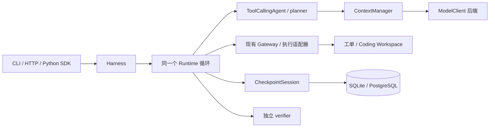

# Harness 底层 R3：Context、Session 与 Checkpoint

后续 [R4 审批续跑](approval-loop.md) 已补齐批准结果回填和 Agent 后续步骤；新建任务默认启用，旧会话保持 legacy 兼容模式。下文的 R3 验收数字保留为当时证据。

[S1–S7 持久调度](scheduler-s5-s7.md) 在这个底层之上复用原 Harness 和检查点，增加独立 worker、租约、过期扫描、旧代隔离和审批唤醒。通用底层可接 Provider；当前自动队列白名单仍仅包含 scripted 工单，不等同于所有 API/Coding 会话都能自动接管。

本轮在已有 Runtime、Gateway、审批和调用台账上增加可组合 Harness：不同模型、任务环境及验证器共用一个循环，支持上下文预算、状态保存及安全续跑。第一版保持同步、串行和少量接口。

## 参考与取舍

| 参考 | 阅读位置 | 采用的思路 |
| --- | --- | --- |
| 本地 Pico | `pico/pico/context_manager.py`、`checkpoint.py`、`runtime.py` | 上下文预算、运行配置指纹、恢复前检查；独立实现 |
| pi | [Agent loop](https://github.com/earendil-works/pi/blob/926b2f8cd8a8ac966f331882557f1bdc98e200de/packages/agent/src/agent-loop.ts)、[Compaction](https://github.com/earendil-works/pi/blob/926b2f8cd8a8ac966f331882557f1bdc98e200de/packages/coding-agent/docs/compaction.md) | 模型适配边界、完整工具调用组、保留近期上下文 |
| DeepSeek Harness | [Architecture](https://github.com/deepseek-ai/deepseek-harness/blob/e8f7b93a344964de3dca1ace9e72b6e4d6de87cb/docs/architecture.md) | 分离模型、工具、会话及循环，从持久状态重建上下文 |
| Claude Code | [官方 Checkpointing](https://code.claude.com/docs/en/checkpointing) | 区分会话与文件状态，明确文件恢复的范围 |

pi 原地址 `badlogic/pi-mono` 当前重定向到 `earendil-works/pi`。研究锁定上述提交，记录在 `artifacts/r3-research/manifest.json`；pi 与 DeepSeek Harness 均为 MIT 许可。本轮没有复制、打包上游实现或安装整个框架，也未引入其插件总线。Claude Code 部分参考官方行为文档。

## 实施路径与代码

| 步骤 | 实施内容 | 主要文件 |
| --- | --- | --- |
| R3.1 | 通用模型接口、有状态 Agent、显式无状态适配器 | `agent.py`、`provider.py` |
| R3.2 | 消息组、上下文预算、确定性历史压缩 | `context.py` |
| R3.3 | 私有 JSON 检查点、配置与完整性检查、Coding 快照 | `checkpoints.py`、`coding.py`、`0011_sessions` |
| R3.4 | 原 Runtime 的暂停/续跑、代际领取、Harness 和 HTTP 接入 | `runtime.py`、`harness.py`、`service.py` |
| R3.5 | 真实进程退出、Docker/PG 验证、兼容回归及演示 | `scripts/harness_demo.py`、相关测试和证据 |



DeepSeekAdapter 保留原入口，继承通用 ToolCallingAgent；真实 HTTP、费用预算和有界重试继续由 DeepSeekClient 负责。Harness 组合原 `run_task`，没有第二套循环。HTTP、CLI 工单演示、Coding 演示已使用 Harness；评测 Runner 使用同一 Runtime 和新模型上下文，但尚未提供评测批次检查点续跑接口。

## Context

ModelClient 接受统一 chat 消息及工具 Schema，返回统一 assistant 消息；其他厂商在此边界转换原生格式。ToolCallingAgent 检查协议、维护批量工具队列和上下文，权限仍由控制面决定。

默认预算为 **16,000 UTF-8 字节、28 条消息**，单条工具结果 4,096 字节、历史摘要 1,600 字节，可通过 ContextPolicy 调整。这是字节预算，并非精确 tokenizer 计数；DeepSeekClient 另有限额。

只压缩已经结束的完整 assistant/tool 组，保留最近一组。待返回结果的批量调用不会被拆开或作为孤儿 tool 消息发送。较早组转换为有界的工具名、结果摘要和预览，以 user-role 的不可信历史数据进入上下文。system 与当前任务不裁剪；无法容纳时返回 `context_budget_exhausted`。

工具正文过大时仅压缩发给模型的预览，不改变 Runtime 原始 ToolResult 或独立 verifier 的证据。压缩会损失细节；本轮没有语义记忆、RAG 或完整历史检索工具。私有检查点链保存阶段快照，公开 Trace 只记录大小、压缩组数及摘要。

## Checkpoint

每份检查点追加保存版本、父检查点、序号、task/run/generation、任务 revision、步数、阶段、SHA-256 及私有 JSON 正文。正文保存原工具结果和调用 ID、已取得的动作/最终文本、Agent 上下文、待消费工具 ID、剩余批量队列、Coding 文件、固定镜像 ID 和停止状态。模型凭据、HTTP token 和 Python 回调代码不进入快照。

单份最大 2 MiB，检查点、当前指针与 Trace 同事务保存。恢复检查版本、内容摘要、配置、步数及任务状态。当前配置重新构造授权，不从历史恢复权限；HTTP 配置绑定主体、范围、请求、策略及验证器版本。模型适配身份、工具 Schema、ContextPolicy、初始 Coding 快照及应用 configuration 参与指纹。

SDK 的 configuration 是调用方明确提供的兼容性契约；自定义工具、模型或验证器行为变化时应更新 configuration/model_identity。框架不会推断任意闭包行为。

| 最新完整阶段 | 恢复行为 |
| --- | --- |
| initial / before_model | 按剩余预算继续请求；崩溃前未知模型请求可能已产生费用 |
| after_model | 使用保存的动作，不重新询问模型 |
| after_tool | 恢复结果、模型队列和 Coding 快照，从下一动作继续 |
| final，任务在 RUNNING / VERIFYING | 使用原最终文本与结果，再做独立验证 |
| before_tool，没有 after_tool | NEEDS_REVIEW，不派发或重放；即使台账有结果，也可能缺工作区快照 |
| WAITING_APPROVAL | 未批准时拒绝继续；R4 新会话批准后可通过 `/continue` 或 `/resume` 回填结果并续跑，旧会话使用业务恢复 |
| 配置变化、损坏、未知版本 | 拒绝恢复，不领取新代际 |
| 已有终态 | 不重开任务 |

请求模型前计步，进程丢失可能占用一步；恢复不重新发放步数。会话绝对截止时间持久保存，并钳制新模型/工作区剩余时间。费用账本沿用原账本。

## 并发与显式恢复

主动暂停发生在结果及快照保存成功后：任务仍为 RUNNING，会话为 PAUSED。`pause_after` 是本次调用完成多少个工具后让出执行，不改变总预算。

续跑领取新 generation，检查点写入核对 owner token/generation，同时提高 Task revision，使旧任务快照不能提交终态。同一暂停会话只有一个正常恢复者。

强杀后 owner 未释放时，需显式 `recover_abandoned: true` 并提交观察到的 `expected_generation`。本轮没有 lease、heartbeat、自动超时接管或重启扫尾。接管使旧执行者后续保存与状态提交失效，但不能撤销已进入容器或外部系统的操作，不等于外部业务 fencing 或 exactly-once。

## 使用接口

| 入口 | 含义 |
| --- | --- |
| `POST /v1/tasks/{id}/run?pause_after=1` | 首次运行，在保存一个工具结果后暂停 |
| `GET /v1/tasks/{id}/checkpoints` | 查询元数据，不返回正文或 owner token |
| `POST /v1/tasks/{id}/continue`，正文 `{}` | 续跑已暂停 Agent |
| 同一 continue，正文 `{"recover_abandoned":true,"expected_generation":1}` | 显式接管已确认退出的代际，按安全边界恢复 |
| CLI `show-checkpoints <task_id>` | 查询元数据，用 `--db` 指定控制库 |

HTTP 沿用身份、角色和任务归属检查。私有正文仍可被数据库操作员读取；不提供正文加密、对象存储或公开下载。`/continue` 与批准工单后的业务 `/resume` 是不同流程。

```python
from safeharness.agent import StatelessAgent
from safeharness.harness import Harness

planner = StatelessAgent(my_planner, identity="my-planner-v1")
harness = Harness(
    store, model=planner, execute=gateway.execute, verify=my_verifier,
    workspace=workspace,  # 工单可省略
    configuration={"app": "v1", "tools": "v1", "verifier": "v1"},
    max_steps=8,
)
paused = harness.run(task, pause_after=1)
# 新进程重建相同适配器和配置后：
finished = harness.resume(task.task_id)
```

有状态 planner 实现 `__call__(results)`、`snapshot()`、`restore(state)`，状态为 JSON。纯函数可显式设置 `stateless_model=True`，声明全部推进状态都由结果导出，不适合隐藏可变计数器的闭包。

模型后端实现 ModelClient 后交给 ToolCallingAgent；可用 `tools=[...]` 传自定义标准化 Schema。对应 execute 适配器仍须校验参数、授权并控制副作用，现有 Gateway 仍只开放原注册工具。扩展无需复制循环。

## 本地验收

2026-11-11：完整回归 **260/260** 通过（较 R2 新增 21 项，0 跳过），固定合成开发验收 **120/120** 通过。真实进程退出演示覆盖工单和 Docker Coding，两种边界分别得到 SUCCEEDED 与 NEEDS_REVIEW；原写文件调用没有重放。新 wheel 在独立虚拟环境中通过恢复演示，53 个 Python 文件与源码一致。旧库只读备份迁移保留 4 条任务快照；Ruff、锁文件及公开证据凭据扫描通过，本轮新增付费模型请求为 0。远程 GitHub CI 尚未执行。

## 亲手演示

```powershell
Set-Location C:\Users\25587\Desktop\agent\safeharness
.\.venv\Scripts\python.exe scripts\harness_demo.py
.\.venv\Scripts\python.exe scripts\harness_demo.py --coding
```

第一条无需 Docker，第二条使用已有 Linux worker；均为合成模型，无付费请求。演示在第二次工具调用后真实退出子进程：一份已保存完整检查点，一份缺少工具后的检查点，再重建模型、Context、Gateway 与工作区并接管。预期 states 为 `SUCCEEDED`、`NEEDS_REVIEW`。Coding 成功分支恢复修复，只执行剩余测试和独立验证；另一分支不重放写文件。

报告位于新建的 `artifacts/harness-demos/<ID>/report.json`。最新本地证据见 `docs/evidence/harness-core-r3.json`；旧 R1/R2/M4 报告保持原样。

当前尚无通用多轮聊天、长期记忆、语义摘要、流式输出、并行工具、插件生命周期、自动调度恢复、文件 rewind、任意宿主仓库导入或外部副作用补偿。适配重点为已有工单、受限 Coding 与自定义 Python 模型/执行适配器；企业真实负载及保留集评测需另行建设。
