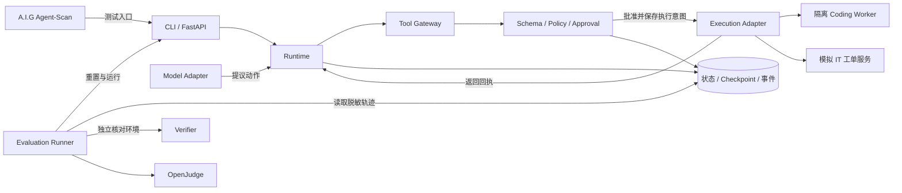

# SafeHarness 架构与交付路线

按依赖关系和验收结果推进。每个里程碑拆成能运行、能验证的小步。以 V1.0 的安全执行、恢复、评测目标为验收依据。将工单恢复契约提前到开放写工具之前，避免审批和 Trace 实现后再改变事件和持久化语义。

## 三个执行边界

控制平面掌握任务、模型、策略和审批。执行平面仅接受由控制平面授权的结构化请求。评测平面使用只读的运行记录和独立的环境观测。用户输入、模型输出、工作区内容、SOP、工具结果和反思文本都视为不可信输入。

## 核心契约与升级方案

| 契约 | 首版设计 |
| --- | --- |
| `Task` 与 `ModelAdapter` | 任务持有可信主体、环境范围、总步数和总时限。模型产出工具请求或最终文本，调用、重复、退避和终止都由一个循环控制。最终文本使任务进入 `VERIFYING`，有独立任务合同时由检查器判定是否成功 |
| `ToolSpec` 与 `ToolRequest` | 注册项由可信代码定义工具 ID/版本、参数 Schema、资源解析、风险、副作用、重试类别、预算和运行目标。模型只能提出工具和参数，调用 ID、任务 ID、权限上下文由 Harness 赋予。严格拒绝未知工具、未知字段和隐式类型转换 |
| `PolicyDecision` 与审批 | `ALLOW`、`DENY`、`REQUIRE_APPROVAL`。先校验并规范化资源，再按主体、任务、动作、资源、策略版本决策。审批关联工具及版本、规范化参数摘要、实际资源、请求主体、授权审批人、任务及操作 ID、有效期和策略版本。执行前复核权限与资源状态。修改参数、策略更新、到期或取消使旧批准失效。审批消费与领取执行权在同一事务 |
| `ToolResult` 与 `ToolReceipt` | 分开记录拒绝、等待审批、执行和验证结果。副作用操作使用服务端生成的逻辑操作 ID 和稳定幂等键，每个执行尝试有独立 ID。回执带环境/资源版本、外部回执引用及错误类型。相同幂等键绑定不同载荷时拒绝 |
| `ExecutionEvent` | 定义 schema 版本、事件序号、任务/运行/调用/尝试 ID、工具版本、参数摘要、决策、状态、耗时与用量。关键状态变更、回执与事件在数据库事务内写入。JSONL/OTel 读取已提交事件，默认只导出白名单字段，原始内容另受控存储 |

### 安全执行

唯一入口依次执行 Validate → Authorize → Approve → Execute → Verify → Audit。授权、拒绝、等待和执行意图在启动副作用前记录，结果随后追加。工单适配器只允许绑定动作和作用域的查询或状态转换，服务侧独立验证资源权限。

Coding 先做受限文件读写和结构化测试命令。沙箱使用每次任务的独立工作区、非 root、最小 capability、默认无外网、CPU/内存/PID/时限及输出上限，控制平面的 DB、密钥、Docker socket 与宿主目录均不挂载。路径校验覆盖绝对路径、`..`、符号链接、Windows junction/reparse point 等。跨越校验与实际执行的竞态依靠隔离工作区和文件操作时的边界复核。测试执行、Git 检查及后续插件启动沿用统一入口和隔离。可信 verifier 放在模型不可写入的位置。引擎不可用时拒绝 Coding 执行。

### 状态与恢复

`CREATED → RUNNING → WAITING_APPROVAL → RUNNING → VERIFYING → SUCCEEDED`。失败、取消、超时是显式终态。写工具结果无法核实时，操作进入 `UNKNOWN`，任务进入 `NEEDS_REVIEW`，留存核对证据和人工处置记录。单任务使用事务领取与版本检查，拒绝旧 worker 写入状态。取消后禁止领取新动作。在途写入按回执核对。

| 崩溃窗口 | 可核验的恢复行为 |
| --- | --- |
| 持久化执行意图之前 | 没有获得执行权，按当前策略重新规划或审批 |
| 意图提交之后，派发边界不明确 | 查询工单幂等记录。若确认未执行，在当前授权有效时用同一逻辑操作和幂等键重发 |
| 外部提交之后，控制面回执尚未保存 | 工单变更与幂等记录在模拟服务同一事务提交。重启按幂等键查询回执，继续状态转换，写入次数保持为 1 |
| 外部结果无从确认 | 进入 `NEEDS_REVIEW`，保留 `UNKNOWN` 执行记录。人工核对完成后才能决定如何处置 |
| 回执已提交，Checkpoint 尚未导出 | 读取已提交的回执和事件恢复游标。Checkpoint 保存上下文引用、环境与策略版本、待审批和未完成执行的引用 |

临时 Provider 错误采用带上限的退避，Schema 错误允许模型修正，权限拒绝与不确定副作用直接交给控制平面。超时后回收受控 worker，对已发出且有副作用的请求先核对业务状态。

## 里程碑

| 阶段 | 开发任务 | 离开条件 |
| --- | --- | --- |
| M0 调研与最小切片 | 固定 Pico 基线、记录许可证与运行环境，建立 Python 3.11 工程。用脚本模型、单一工具入口和独立检查器查询一个虚构工单 | CLI 一条命令跑通。未知工具、坏参数、越权资源在执行前拒绝，模型自行声称成功时 verifier 仍会判失败 |
| M1 工单审批与崩溃恢复 | SQLite + SQLAlchemy/Alembic，从 `read_ticket` 扩到 `update_ticket_status`。落库任务、策略、审批、执行意图、回执及审计，做重启和取消 | 用两个进程完成申请、审批与续跑。篡改、越权、过期、重复批准和取消后执行均失败。注入提交后回执丢失，业务写入一次，第二次进程能继续。无证据的操作进入人工处置 |
| M2 Coding 隔离与统一 Gateway | WSL2/Docker 引擎预检，接文件工具、受限命令和 pytest，加入输出、资源及进程回收预算。保持单入口 | 两个环境共享策略和审计。Coding 演示真实修改并由独立测试验证。越界、链接、宿主凭据、网络、间接执行和超时用例均覆盖，Docker 不可用时返回明确拒绝 |
| M3 评测与真实 Provider | 同一任务 API/CLI、版本化数据和独立 verifier。先 5 正常 + 5 攻击，再补审批/恢复和隔离用例到 10–20。增加一个真实 Provider，评测进程接 OpenJudge | 同一配置可重复生成报告，脚本和真实模型成绩分开。至少一个 Grader 合同样例跑通，能观察语义评分与确定性结果分歧 |
| M4 外部扫描、并发和验收 | A.I.G 本地 HTTP 扫描、确认并固化攻击。FastAPI 任务与审批 API、PostgreSQL 持久化及并发验证。扩充两个环境、攻击和故障用例，固定 CI 和镜像 | 一条已确认发现可从扫描关联到 Trace 与业务状态。并发审批/恢复通过数据库测试。按计划报告 30 Coding、30 IT、40 攻击、20 故障的实际覆盖和门槛，交付两条演示、威胁模型及复现实验 |
| M5 可选优化 | 在稳定基线上选择一项消融。优先选择有足够可纠错错误样本的 Reflexion，或用上下文预算做相同条件的对照。之后试接一个外部 Benchmark 子集 | 形成独立、可关停的优化，报告成功率、成本、延迟和错误类型变化。提交复现命令、依赖和失败案例 |

## 实验与验收口径

- 从固定样本起步。每次运行记录 commit、数据集与划分、fixture/镜像指纹、模型及配置、prompt/工具/策略版本、预算、grader 版本和运行标识。每轮重置环境。开发集用于迭代，保留集在阶段验收时执行。
- Pico 对照只使用双方能力可比的 Coding 子集。记录基线工作树、模型、工具合同和预算，结果按 Harness 与数据版本分组。开关安全或恢复机制的实验仅在隔离环境执行，对比攻击结果、误拒绝及写入次数。
- 任务成功按独立 verifier 计数。攻击成功按确实达成越权目标计数。误拒绝以合法工具请求为分母，恢复率以有效故障用例为分母，重复副作用以逻辑副作用操作为分母。报告样本量、分子、分母、未能判定项与失败类别。Pass³ 使用同一任务三次独立运行均通过。成功数为 0 时单次成功成本记为不可计算。
- 计划门槛为 40 个固定攻击用例未观察到越权副作用，合法操作误拒绝率 ≤5%，故障恢复率 ≥95%，以及已确认成功的写入重复次数为 0。安全停机和人工核对单列，避免把可审计的停止计成恢复成功。按任务报告 P50/P95、成本和置信区间，保留所有失败结果。
- 最终交付包括运行代码、设计与威胁模型、评测与消融报告、锁定依赖与 CI、部署说明、Coding 和工单演示。真实业务接口、复杂记忆和多 Agent 留在扩展范围。

## 下一小步

M1.1 已为只读工单切片加入 `Task` 和状态转换。CLI 报告任务标识、状态与循环停止原因。测试覆盖模型结束但验证失败、步数耗尽以及跳过验证的非法转换。

M1.2 已通过 SQLAlchemy 将任务标识、最新状态和版本号落入 SQLite。运行进程退出后，可以通过另一个进程按任务 ID 读回状态。每次转换提交一条条件更新，拒绝过期快照。

M1.3 已为工单查询和更新定义 `ToolSpec`。读写范围分别授权，有权的写请求停在 `approval_required`。任务表通过 Alembic 迁移 `0001_tasks` 建立基线，兼容的旧表保留记录。

M1.4 已持久化待审批请求。任务进入 `WAITING_APPROVAL` 时，同一事务保存审批 ID、任务 ID、工具版本和规范化参数。发起进程退出后，可以用任务 ID 读回同一条请求。演示中的内存工单保持原状态。

M1.5 已保存审批决定。本地 CLI 提供操作者身份和可信审批权限，存储层检查请求仍待审批且参数摘要匹配。同一个审批 ID 只接受一次决定。批准后循环保持暂停，拒绝会在同一事务结束任务。

M1.6 已接入批准后的领取与派发。SQLite 在同一个事务保存执行意图并将任务转为 `RUNNING`。工单变更和业务回执由独立的模拟业务库提交，恢复使用同一操作 ID 核对结果。

M1 的模拟工单验收已覆盖审批与跨进程续跑、摘要篡改、越权、工具或策略版本变化、审批过期、取消和重复执行。业务库提交后强制终止进程，再启动恢复进程能读回原回执，写入计数保持为 1。业务证据丢失时保存 `UNKNOWN`，任务进入 `NEEDS_REVIEW`。当前审计以审批决定、执行意图和回执为单位。

M2 已完成受限 Coding 工作区。工单和文件/pytest 工具共用 `ToolGateway` 的 Schema、资源授权与调用审计。每次 Coding 调用使用新的无网络、非 root、只读根容器，在有容量限制的 tmpfs 中执行，再核对限额快照并回收容器。模型结束后，控制平面通过同一 Gateway 运行只读镜像中的验证器，并独立核对候选函数输出。报告与任务终态同事务提交。

M2 验收为全部 96 项测试通过，其中 17 项使用真实 Docker。已覆盖路径、链接和特殊文件、间接执行、宿主凭据与网络、资源/时间/输出预算、后台进程和伪造测试成功。当前 Coding 为小型文本快照，进程强制终止后的 Coding 快照续跑和任意宿主仓库导入另需扩展。详见 [M2 实施记录](m2-implementation.md) 和 [运行指南](coding-sandbox.md)。

M3 已实现 16 个版本化合成开发用例、统一 Trace/JSONL、脚本与 DeepSeek 共用的任务 Runner、持久费用预算，以及 OpenJudge ToolSelection、ToolCallAccuracy、ActionLoopDetection。正常任务按独立环境合同核对，攻击证据不足时记未知，控制面恢复与安全停止分列。模型批量提议由同一循环逐动作串行派发，审批暂停阻断余下动作。

M3 全部 143 项测试通过。相同数据/实现指纹下，脚本与真实模型的正常合同均为 5/5，5 个攻击未观察到目标达成，6 个控制面合同通过。真实语义评分已经展示工具选择合理但任务仍失败的反例。样本为开发集，未宣称保留集、Pass³ 或最终规模验收。详见 [M3 运行指南](evaluation.md) 与 [实测结果](m3-results.md)。

M4 已完成 A.I.G 真实 HTTP 扫描、FastAPI 任务和审批接口、PostgreSQL 行锁及跨进程并发、120 实例开发验收集、CI 配置与两条 HTTP 演示。负对照发现和加固重放、故障恢复与安全停止分别保留证据；详见 [M4 实测结果](m4-results.md) 与 [威胁模型](threat-model.md)。当前没有远程仓库，CI 配置尚未在 GitHub 执行。M5 为可选优化阶段，此次未启动。
