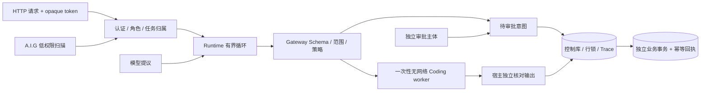

# SafeHarness 威胁模型

本项目保护控制平面的数据库、审批身份、宿主凭据、受限工作区之外的文件，以及模拟业务操作的唯一性。模型输出、工具参数、候选代码、pytest 文件、外部扫描请求和模型 grader 都按不可信输入处理。宿主账号、Docker daemon、控制平面程序、授权配置、数据库管理员和固定 worker 镜像属于可信计算基。

| 威胁 | 控制 | 已执行证据 | 剩余边界 |
| --- | --- | --- | --- |
| 模型伪造审批、选择身份、跨用户操作 | strict Schema、服务端主体、角色、所有权、自批禁止、独立读写范围 | HTTP 拒绝测试、两进程 PG 实测 | opaque token 是本地原型，泄露会继承该角色；管理员可改授权 |
| 审批后替换参数或策略 | 规范化 JSON 摘要、工具/策略版本、24 小时首次派发 TTL、当前权限重查 | 摘要/版本/过期/撤权测试 | 当前策略版本为代码常量，升级需运维迁移约定 |
| 崩溃重试引发重复写 | 意图持久化、任务行锁、业务原子回执、操作 ID 重用 | SQLite/PG 真进程退出恢复、四并发续跑 | 只对支持幂等回执的模拟业务适配器成立，不能泛称任意外部 API exactly-once |
| 证据丢失后盲目重试 | UNKNOWN + NEEDS_REVIEW，禁止无证据猜测 | 两后端 evidence_missing、安全停止测试 | 人工核对工作台和修复流程尚未实现 |
| 路径穿越、链接、特殊文件回传 | 白名单相对路径、openat/no-follow、单链接普通文件、快照限额 | 40 攻击集及 Docker 链接/FIFO 测试 | 仅小型 UTF-8 文本快照，不支持任意宿主仓库挂载 |
| 间接执行逃逸与宿主/网络访问 | 非 root、只读根、cap drop、no-new-privileges、seccomp、无网络/宿主挂载/socket | smoke probe、间接代码、宿主凭据/网络测试 | Docker 共享宿主内核，不能视为 VM；内核/daemon 漏洞不在本次证明范围 |
| 内存/进程/磁盘/时间/输出耗尽 | cgroup、tmpfs、调用/任务预算、输出截断、容器回收；持久工单队列容量限制 | Docker 资源测试、SQLite/PG 并发容量测试 | 手动运行信号量仍按进程；没有涵盖所有任务和费用的用户配额 |
| 旧 worker 恢复后覆盖新执行者 | 数据库时间租约、独立心跳、token/generation 与 checkpoint 绑定，失权后停止本次派发/提交 | S5 旧进程命名检查点释放、S7 实际数据库中断及关键窗口重复验证，见调度证据 | 不能撤回已经发出的外部请求；常驻消费者可另取新任务，完整故障退出仍需进程托管 |
| 审批丢唤醒或取消后复活 | WAITING 释放槽位、决定与 READY 同事务、领取后再核对状态与审批 | 批准/拒绝/取消、事务回滚、收尾竞争、提交后回执恢复 | 自动队列仅支持 scripted 工单，Coding 与真实模型尚未自动调度 |
| 候选测试伪造成功 | 只读镜像验证器、宿主保留期望答案、验证后快照不变 | 错误实现反例、30 函数实例先检出 bug 再修复 | 有限合成用例不能证明任意代码正确，开发集可被针对性拟合 |
| 外部扫描器获得生产权限 | 单独 venv、固定来源、scanner/model_proxy 分权、只读合成目标、原 API 无扫描权限放宽 | A.I.G 真扫描 + 同请求加固重放 + 离线强制工具回归 | 扫描器是受信任测试程序；独立 venv 不是 OS 沙箱，不向它提供宿主源码或真实业务数据 |
| 模型请求超支/密钥泄漏 | 持久费用预留、未知用量保留、固定模型/超时/重试、密钥只在宿主 Provider、公开 Trace 只存摘要 | 共用 0.50 CNY/80 请求账本，脱敏检查 | 价格快照需人工更新；预算账本为单机 SQLite，生产多机需统一预算服务 |

PostgreSQL 控制表与模拟业务表在同一实例、不同事务中提交。它验证控制提交和业务提交之间的故障窗口，不模拟跨地域业务数据库的独立可用性。数据库和 Trace 当前可由宿主/DB 管理员修改，尚无防篡改签名或外部审计存储。

[S5–S7](scheduler-s5-s7.md) 另外使用独立回环 HTTP mock 验证“业务提交后断开 TCP”：适配器查询原幂等回执，回执缺失或不可用时不盲目重发。这个合同仍依赖业务端可信的原子回执，不是任意远程服务的 exactly-once。数据库中断演示只操作新建专属容器；持续运行采用独立测试 schema。具体运行时长与结果见 [机器证据](evidence/scheduler-s5-s7.json)。

A.I.G 已确认的是**故意配置过宽读取范围的合成负对照**，不是正式加固入口的已知突破。加固入口通过 Gateway 拒绝 IT-002；报告同时保存负对照失败、重放成功和业务零写入，不能用扫描器的风险分数替代这些证据。

验收集全部为开发集：30 Coding 是 10 函数的三种 bug，30 IT 是 10 工作流的三种初始状态，20 故障是 10 窗口/规则在两个后端运行，40 攻击来自 5 类边界。没有保留集、Pass³、真实工单系统或生产 SLA 结论。对外展示时应同时提供样本量、置信区间和这些限制。
